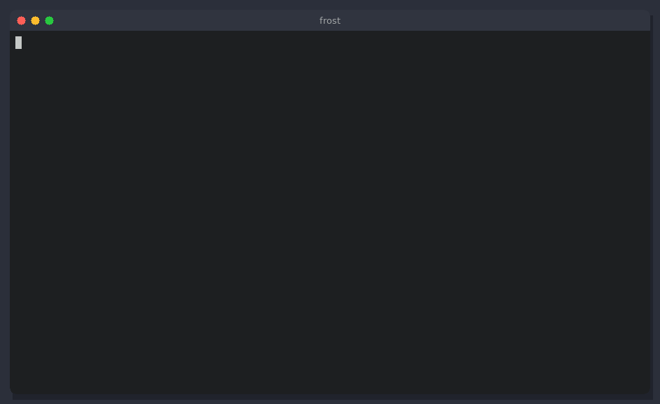

# frost

A small terminal text editor in Rust. Layout like [Fresh](https://github.com/sinelaw/fresh) (menu bar, tabs, gutter, status bar, command palette), keys like micro,
CUA clipboard, mouse, multi-cursor, and Notepad++-style sessions. About 2000 lines, 4 real dependencies.



    ./install                     # builds and installs to ~/.local/bin (PREFIX=/usr/local with sudo for system-wide)
    ./run                         # or: ./build (incremental; BUILD_FORCE=1 forces) and start without installing
    ./install -rebuild            # same install after a full rebuild
    frost                         # reopen the last session
    frost FILE[:LINE]...          # editor call (git, nnn, $EDITOR): the session comes back and FILE opens on top of it
    export EDITOR=frost VISUAL=frost

## What it has
- **Keys (CUA + micro):** Ctrl-S/O/N/W/Q, Ctrl-Z/Y, Ctrl-X/C/V (system clipboard), Ctrl-A, Ctrl-F (live search) F3/Shift-F3, Ctrl-H replace all, Ctrl-G line, Ctrl-K delete line, Ctrl-Shift-D duplicate, Tab/Shift-Tab indent, Ctrl-P command palette, F1 keys, F10 menu.
- **Key hints:** the bottom line shows the keys that matter right now (idle, selection, several cursors, search, menus, pickers) and gives way to a short message (`copied 3 lines`, `pasted`, `saved`, `nothing to undo`) that fades. Dispatch, menus, hints and the key panel all come from one table (`src/keys.rs`), so none of them can disagree.
- **Tabs from the keyboard:** Alt-. / Alt-, (or Ctrl-PgDn / Ctrl-PgUp) next and previous, Alt-1 to Alt-9 go to that tab, Alt-0 to the last one.
- **Key panel (F1):** every action with its keys, `(none)` if unbound. Type to filter; Enter on a row, then press the new key (it replaces the old ones); Ins adds a second key, Del unbinds, Ctrl-R restores the default. A key another action already has is shown and taken only when you press it a second time. Changes apply at once and are saved to `keys.lua` next to init.lua (it holds only the differences from the table and is read after init.lua; delete it to start over). A bare letter cannot be bound, it would stop typing.
- **Mouse:** click, drag, double-click word, triple-click line, wheel, tabs, menus (they open when you point at them, like Fresh), Alt/Ctrl-click adds a cursor.
- **Multi-cursor:** Ctrl-D selects the word, then the next occurrence each press (a whole word stays a whole word, wraps around); Alt-A all occurrences, Alt-S skip one, Ctrl-U drop the newest cursor, Alt-L one cursor per selected line, Alt-Up/Down a cursor above/below, Alt-click adds or removes one. Every edit (each cursor keeps its own indent on Enter), copy/cut/paste (each cursor gets its own piece back) and delete works at all cursors; cursors that collide merge; Esc goes back to one.
- **Huge files:** a file over 8 MB shows its first screen at once (about 150 ms for 811 MB / 10 M lines on 12 cores) while all cores stream the rest in; the status bar shows `loading NN%`. Memory is about 1.4x the text, not 2x. Search works line by line, saving streams to disk. The first edit waits for the load to finish. Far jumps do not re-parse the highlighting. Not tried above ~2.4 GB.
- **Sessions (Notepad++ style):** open tabs, cursor, scroll, language *and unsaved or untitled text* are saved on quit (and every 7 s when something changed) and come back on the next start. Named sessions under File. Closed tabs stay reachable after a restart: Ctrl-T reopens the last one, File > Closed tabs... lists them. Frost always starts: a tab whose file is gone, unreadable or not a regular file is skipped with a status message, a damaged undo history only loses that history, and a session file that cannot be read or crashes the first frame is moved aside as `session.json.bad-<unix time>` while frost starts empty. A window with 0 rows (not sized yet) or a closed pipe on stdin does not stop it either.
- **Infinite undo/redo, compact:** nothing is ever forgotten, but it stays small. Runs of typing or backspace are one step; past 3000 steps the older ones are merged pairwise (recent history stays fine, old history gets coarser, it still reaches the first text). On disk each tab has its own deflate-compressed file of small deltas (`~/.local/state/frost/history/`), written every 7 s for texts up to 256 KB and on quit for up to 4 MB, and unused files are deleted. A power cut loses at most 7 s; SIGTERM/SIGHUP (shutdown, closed terminal) save like a normal quit.
- **External changes:** when another program (Claude, a formatter, git) writes a file you have open, frost notices within about a second (one `stat` per tab). A tab without unsaved edits reloads (Ctrl-Z goes back). A tab with unsaved edits is left alone (the status bar says `NAME changed on disk, yours kept`); no merge, no markers. Ctrl-S then does not overwrite the changed file: your version is written next to it as `NAME.frost-mine`, the original stays untouched and the tab stays modified. If the file did not change on disk, Ctrl-S saves normally. Files over 4 MB (and big files loaded in the background) are not followed.
- **Dictionary / word jump:** F4 opens a prompt, type a word and pick from the unique words of the tab (prefix, substring, fuzzy; line number and count shown) plus dictionary words; Enter jumps there, F5 / Shift-F5 go to the next / previous occurrence. F2 explains the word under the caret. Sources: a built-in list, `~/.config/frost/dictionary.txt` (`word<TAB>meaning`) and `/usr/share/dict/words`. The old completion popup is off; `frost.autocomplete = true` in init.lua turns it back on.
- **Diff:** File > "Diff with file on disk" and "Diff with another tab..." open a unified diff in a tab (syntax-coloured `+`/`-`).
- **Languages:** 199 syntaxes, picked by extension, file name or shebang; Ctrl-L lists them A-Z with letter markers, typing filters (prefix matches first).
- **Brackets and indentation:** typing `(` `[` `{` `"` `'` adds the partner (and steps over it, wraps a selection, `Backspace` removes an empty pair, Enter between `{}` opens three lines); indentation copies the file's own (tabs or N spaces) and grows after `{`; matching brackets are marked, unclosed ones are red with a status-line warning; Lisp is strict (no unbalanced edit gets through) and lines up like Emacs. Per language and configurable: [docs/brackets.md](docs/brackets.md).
- **Config in Lua:** `~/.config/frost/init.lua`, see below.
- Line endings (LF/CRLF) are kept.

## Config (Lua)
```lua
frost.theme = "terminal"          -- terminal (default: your terminal's own colours), dark, light, gruvbox, mono
frost.colors.accent = "#ff8800"    -- bg bar dim fg accent sel cursor2
frost.line_numbers = true
frost.tab_width = 4               -- display width of a tab, and the indent when a file has none yet
frost.auto_pair = true             -- see docs/brackets.md for frost.pairs and frost.strict
frost.dictionary = "/path/to/words.tsv"
frost.keys["ctrl-j"] = "goto"      -- key spec -> action name (save, quit, tab3, find, ...) or "none"
```
A broken file shows its error in the status line and the defaults are used. In the default `terminal` theme everything, syntax colours included, uses the terminal's palette (ANSI), so frost matches your terminal theme.

## Platforms
Linux is what it is developed and tested on. The code has no Linux-only parts: clipboard tries wl-copy, xclip, xsel, pbcopy, clip.exe and PowerShell; state and config go to XDG, `~/Library/Application Support` or `%APPDATA%`; big files are read with `read_at`/`seek_read`. macOS, Windows and the BSDs are **not tested yet**.

## Not here (on purpose)
No LSP, no plugin system beyond the Lua config, no file tree, no soft wrap, no split panes. It is meant to stay a small editor like micro, a bit better, not a VS Code clone.

## Tests
`./test` runs everything: the Lean 4 proofs in `lean4/Frost.lean` (applying the history delta of a to b gives b; only the axioms propext and Quot.sound), regenerates the 14641 oracle cases from the Lean model and checks the Rust `delta` against all of them, then `cargo test` (buffer, multi-cursor, lazy load, history, disk sync, session, dictionary, diff, config) and `tests/startup.rs`, which starts the real binary in a pty with a corrupt session, bad tabs, 0 rows and a closed stdin.
`tests/keypanel` then drives the real binary in a private tmux (own HOME and XDG dirs): tab keys, the F1 panel, keys.lua, a restart.
The Lean part covers the undo-history delta only; the rest of the editor is covered by ordinary Rust tests.

## Speed

`./bench` (release build, about a second after compiling) prints numbers from this machine, a single run, no averages:
open a 100 MB file 2 ms to the first screen (84 ms to load the rest), 1000 cursors typing together 2.5 ms. Your machine will differ; the point is that none of it is
quadratic.
